

  

<h1 align="center">GoodMorning</h1>

  A self-hosted AI secretary: a morning briefing, an evening review, one schedule, 
  and a chat that keeps your to-dos and ideas.

  <strong>English</strong> · <a href="README.zh-CN.md">简体中文</a>

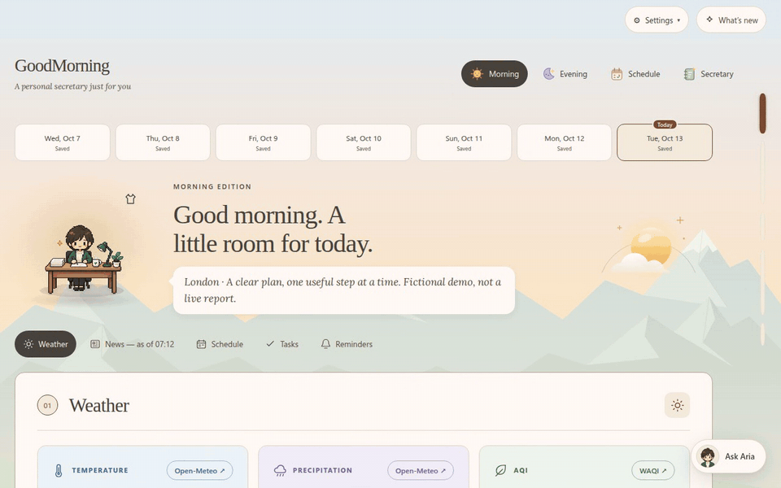

## What it does

Your plans are spread across a calendar, a notes app and old chats, and every
morning you put them back together by hand. GoodMorning keeps them in one
record, and an AI agent turns that record into two briefings a day:

- **Morning:** weather with hourly charts, news from the last 24 hours, today's
  appointments, today's tasks, and anything that needs a decision.
- **Evening:** what you finished, what's still open, and tomorrow. Optional
  sections show stocks, new episodes of your shows, and game sales.
- **Schedule:** your calendar and dated to-dos in a week or day view.
- **Letters:** on Sunday evenings, a short letter about your week: what you
  finished, habits you kept going, ideas you saved and next week's plans, kept
  to look back on.
- **Secretary:** a chat that saves to-dos, ideas, habits and errands, and asks
  when something is unclear.

It shows what you saved. It never marks work done, moves a date or invents a
task on its own: unfinished work stays where it was until you say otherwise.

## Tell your secretary

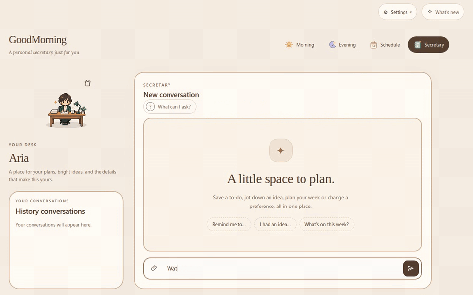

Write the way you would to a person. One message can hold several things;
each is saved as the right kind of item:

- **To-dos** with a day, a deadline, or both.
- **Habits** such as "every Tuesday and Saturday", with exceptions.
- **Ideas** that stay ideas until you adopt them.
- **Heads-ups** and **reference notes** that never ask to be ticked off.
- **Errands** such as "check this price each morning", reported in your
  briefing only when the result is what you asked to hear.

A floating **Ask** button opens the same chat from any page. You can attach
files and images.

## Morning

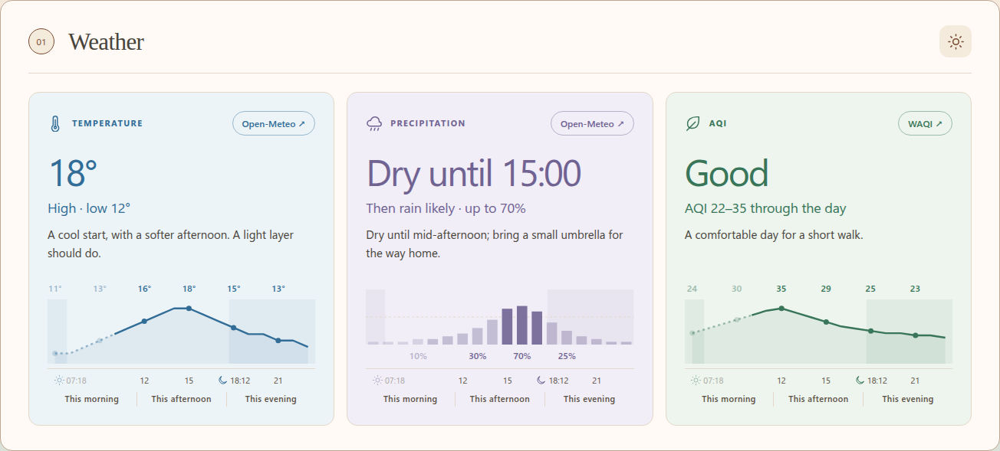

<table>
  <tr>
    <td width="50%" valign="top"><a href="assets/readme/news.png">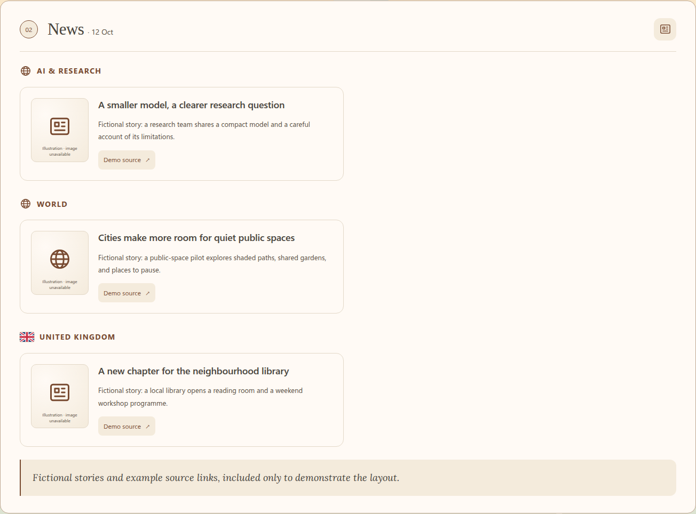</a></td>
    <td width="50%" valign="top"><a href="assets/readme/tasks.png">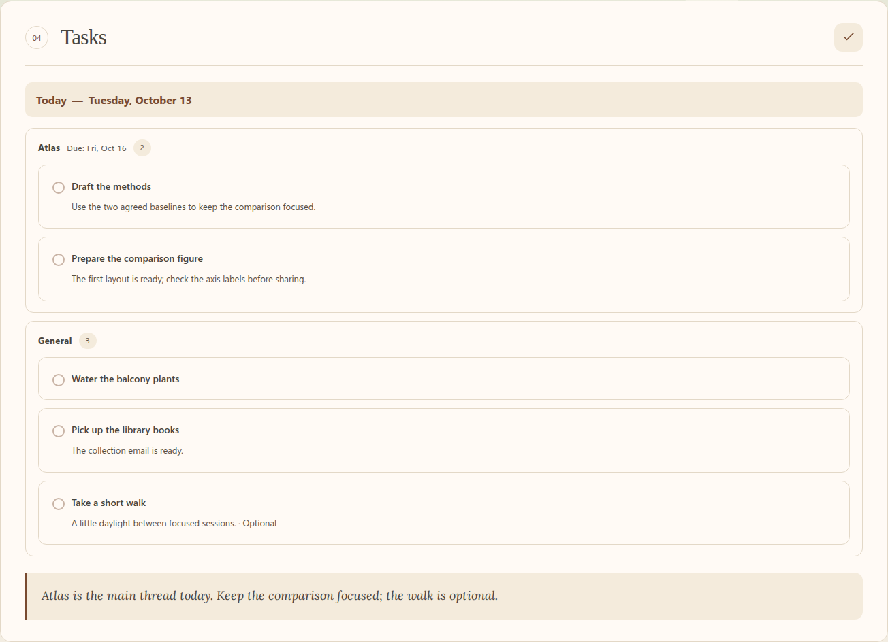</a></td>
  </tr>
  <tr>
    <td align="center">News from the last 24 hours, with sources, skipping stories you've already seen.</td>
    <td align="center">Tasks by day and project, deadlines marked, optional work kept apart.</td>
  </tr>
</table>

Sections appear as they are written, so you can start reading before the whole
briefing is done. Changes from your synced calendar (a published `.ics` link)
are applied automatically, and Reminders mentions each one once.

## Evening

<table>
  <tr>
    <td width="50%" valign="top"><a href="assets/readme/evening.png">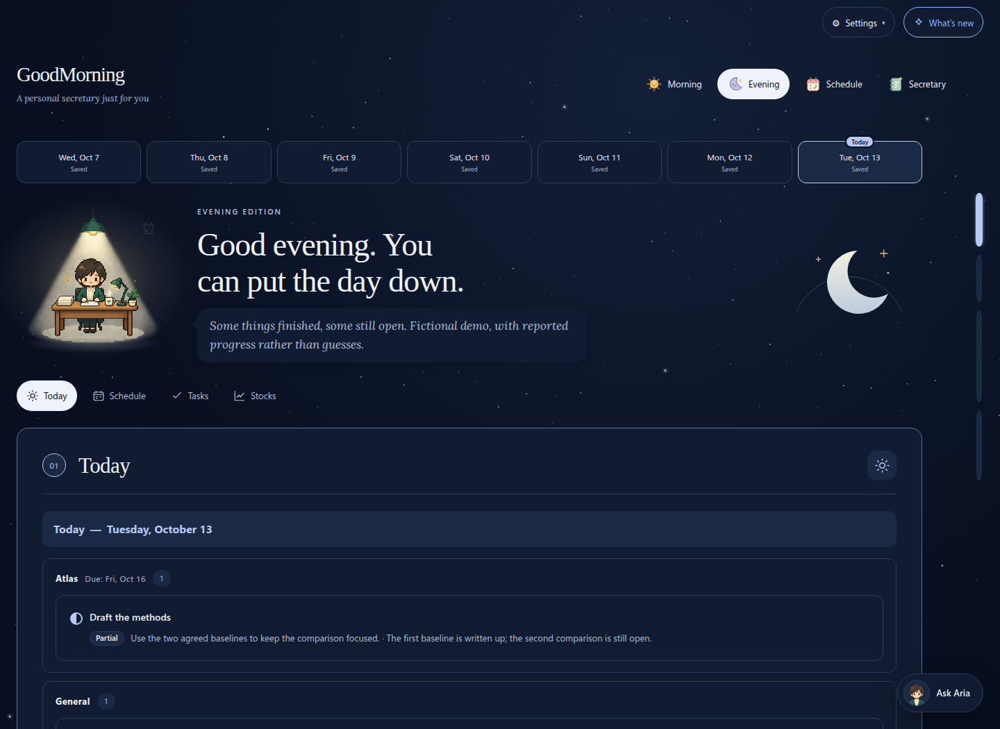</a></td>
    <td width="50%" valign="top"><a href="assets/readme/stocks.png">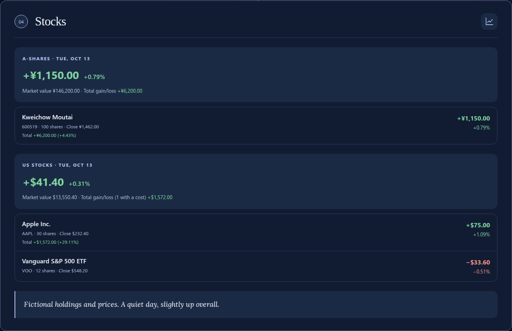</a></td>
  </tr>
</table>

After the evening briefing is written, a short check-in goes through today's
due tasks one at a time, then asks about anything you finished early. Only your
answers change a task, never a guess.

## Schedule

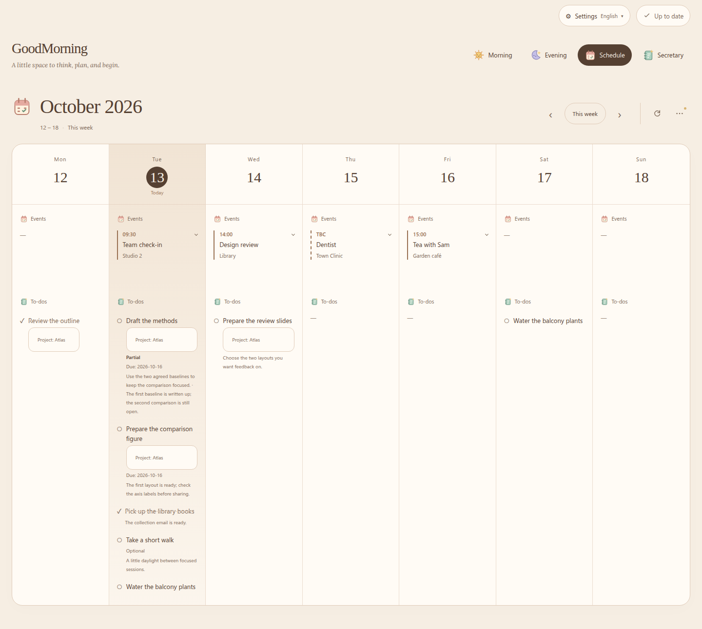

The Schedule page reads your saved records directly: no AI call, no generated
plan. Appointments with an unknown time are marked as such.

## Looks

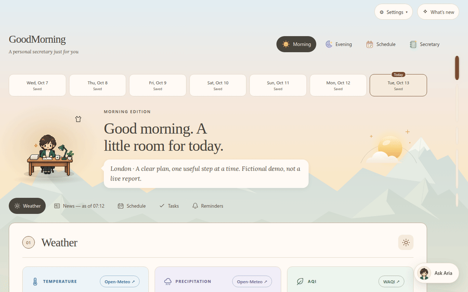

Choose a **Soft** or **Pixel** style, a day color scheme and a night color
scheme, separately on each device. Pick a secretary avatar and name, and how
it should talk to you. **About me** in the Account menu shows what your
secretary knows about you: change simple details there, the rest in chat.
The whole site is available in English and Simplified Chinese.

## On your phone

<table>
  <tr>
    <td align="center" valign="top">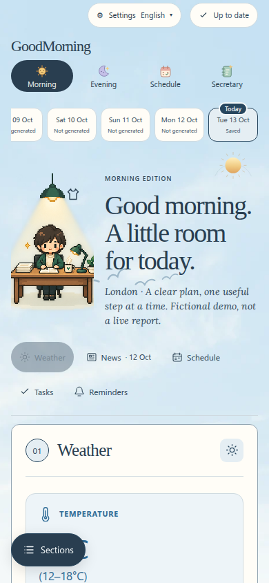</td>
    <td align="center" valign="top">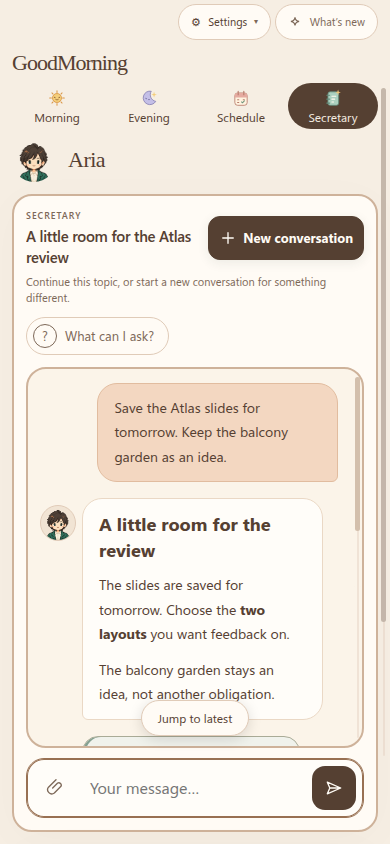</td>
  </tr>
</table>

The website works on phones. The [Android app](docs/android-app.md)
(beta, [releases](https://github.com/S-Sebb/GoodMorning/releases)) adds:

- **Widgets:** today, the week, briefings, news, weather, the secretary chat,
  and a quick-note sticky that your secretary can sort later.
- **Notifications** when a briefing is ready, a reply is finished, your
  secretary needs an answer, or an event is about to start, plus a morning and
  evening reminder at your chosen times if that briefing isn't prepared yet. Browsers can get
  these too.

## Getting started

GoodMorning is in **beta**. It is not a standalone chatbot: it needs

- **Linux** with **Python 3.14+**,
- an **[OpenCode](https://opencode.ai)/OpenChamber** agent with model access
  (English requests use Muse Spark, Chinese requests DeepSeek V4.1 Flash),
- **Node.js 22.18+** only for optional project access.

1. Install the `goodmorning` skill with the [deployment guide](docs/deployment.md).
   For the browser viewer, see the [browser guide](docs/browser-delivery.md);
   hosting it publicly needs the [security setup](docs/website-security.md).
2. Open **Initialize** in the browser. Your secretary asks for your
   preferences, location and integrations; anything optional can wait.
3. Prepare a briefing from Morning or Evening, or start a chat.

Weather, modelled air quality and news need outbound HTTPS but no API keys.

## Privacy

- Personal records live in your own runtime, outside this source tree.
- The hosted setup supports HTTPS sign-in, encrypted storage and separate
  accounts.
- Self-hosting does not hide requests from your AI provider, and encryption does
  not hide live data from the server's administrators. See the
  [security boundaries](docs/website-security.md).

## More

[Item types and timing](docs/item-taxonomy.md) ·
[Schedule](docs/weekly-schedule.md) ·
[Weekly letters](docs/weekly-letters.md) ·
[Evening tidy-up](docs/evening-tidy-up.md) ·
[Celebrations](docs/celebrations.md) ·
[Browser chat](docs/browser-chat.md) ·
[Project access](docs/project-access.md) ·
[Source layout](docs/project-structure.md) ·
[Issues](https://github.com/S-Sebb/GoodMorning/issues)

Screenshots use fictional data, made by the [demo helper](tests/browser/readme_demo.py)
without any model calls.

## License

[MIT](LICENSE). Bundled [relay code](vendor/openchamber-relay/LICENSE) and fonts
([text](assets/web/fonts/OFL.txt), [pixel](assets/web/fonts/pixel-fonts-OFL.txt))
keep their own licenses; theme imagery has [asset credits](docs/theme-asset-credits.md).
