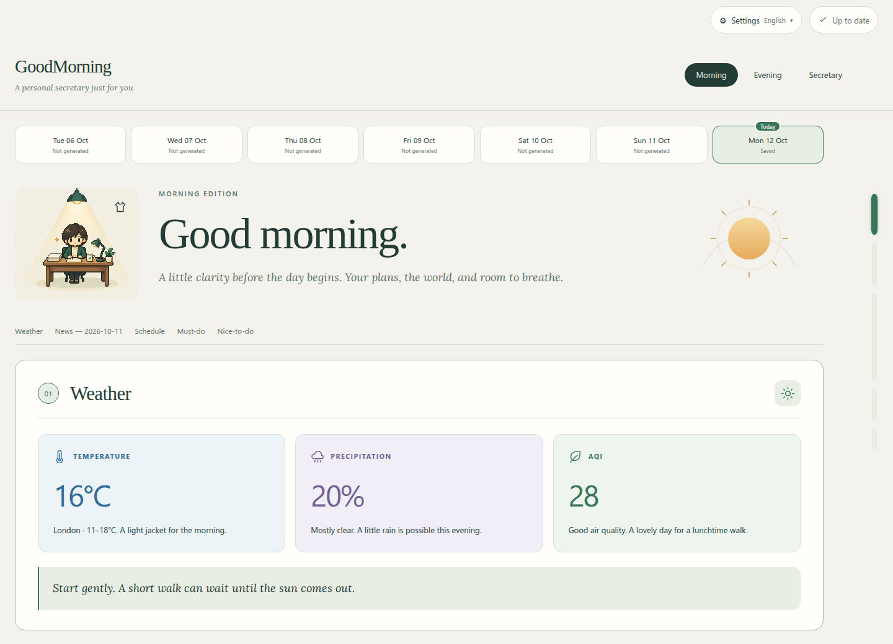
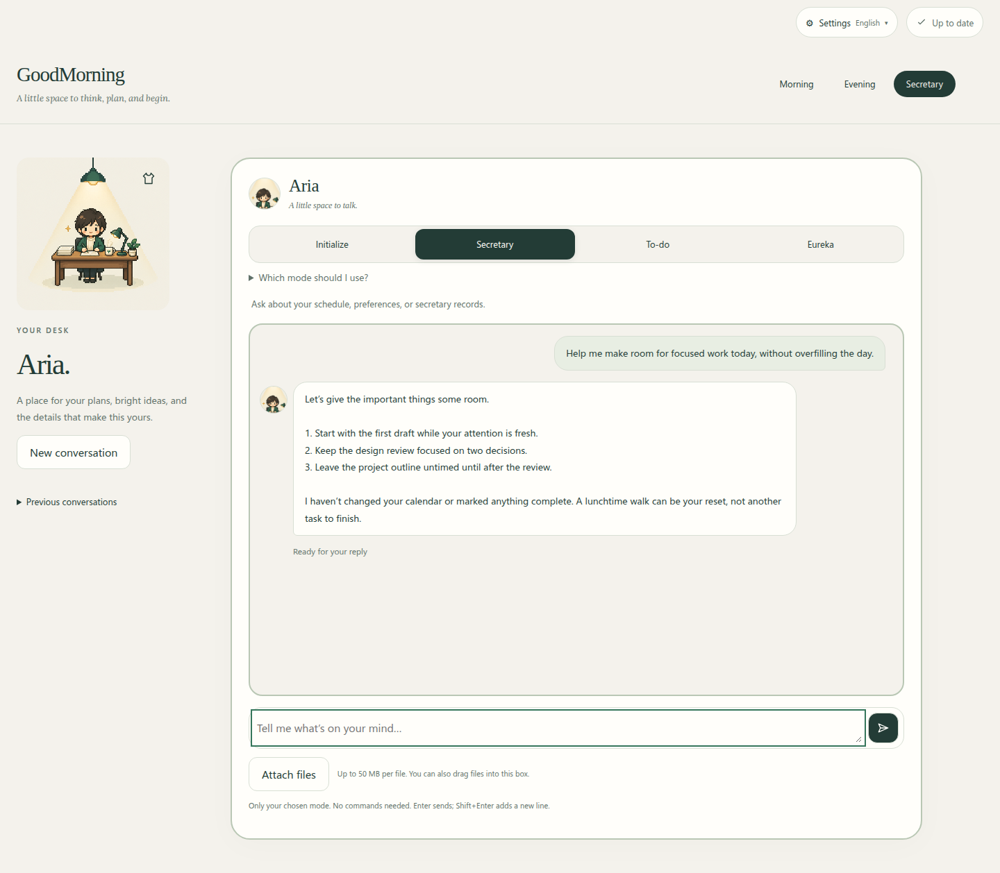
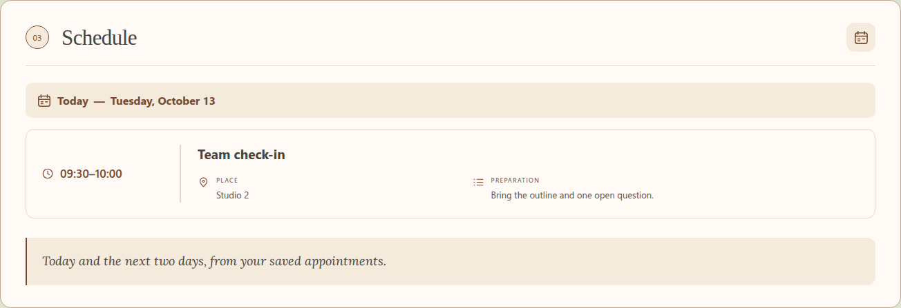
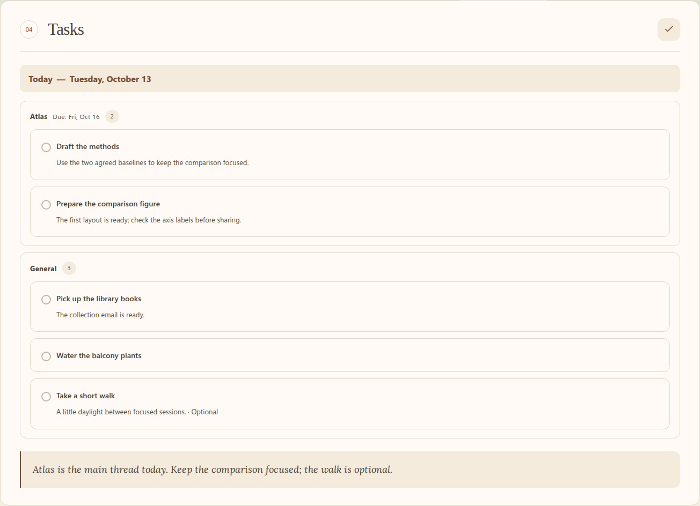
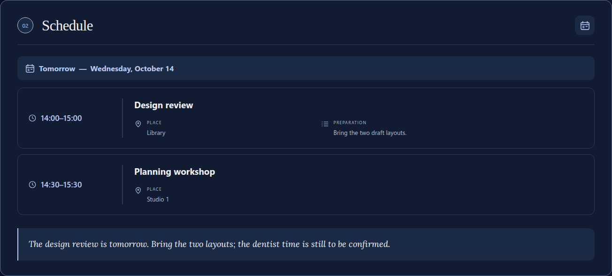
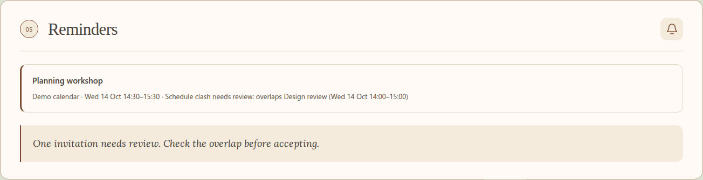
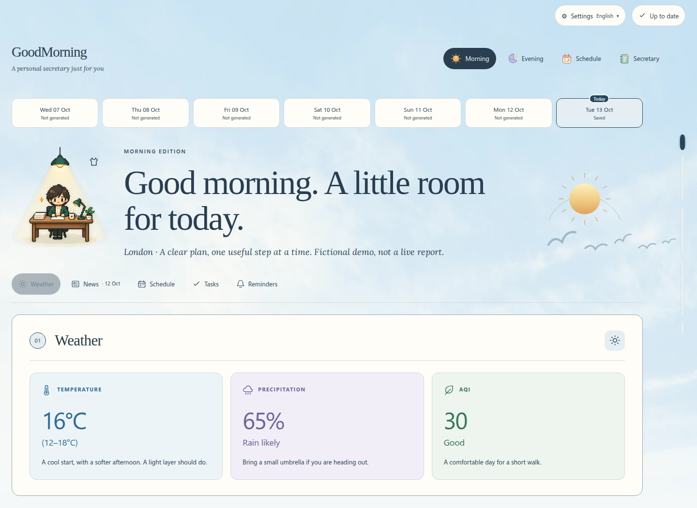

  

<h1 align="center">GoodMorning</h1>

  <strong>A calmer start. A clearer finish. A little space to think.</strong> 
  Your personal AI secretary for the plans, stories, and ideas that make up your day.

  <strong>English</strong> · <a href="README.zh-CN.md">简体中文</a>

  <a href="#a-day-with-goodmorning">Explore</a> ·
  <a href="#inside-the-briefings">Screenshots</a> ·
  <a href="#make-it-yours">Get started</a> ·
  <a href="docs/deployment.md">Documentation</a> ·
  <a href="https://github.com/S-Sebb/GoodMorning/issues">Feedback</a>

GoodMorning brings your weather, news, appointments, tasks, and ideas into one
quiet place. Start with a morning briefing, keep your saved plans close throughout
the week, and close the day with an honest review of what actually happened.

Between briefings, your secretary helps you think, remember a to-do, or catch an
idea before it disappears. Built around **OpenCode and OpenChamber**, GoodMorning
combines a personal AI workflow with a browser interface you can host yourself.
Four tabs—**Morning, Evening, Schedule, and Secretary**—keep each part of the day
within reach.

## A day with GoodMorning

**Morning · Find your bearings.** Weather, News, Schedule, Tasks, then Reminders:
a familiar order for local conditions and air quality, yesterday's source-linked
stories, upcoming appointments, saved actions, and decisions that need you.
Tasks are grouped by workday and project, with clear action titles and essential
work kept distinct from optional possibilities. Sections appear as they are
prepared, so you can start reading before the whole briefing is ready.

**Evening · Put the day down.** Report completed work, partial progress, and
blockers, then look at tomorrow's appointments and agreed tasks. Unfinished work
stays visible without silently moving to a new date. Completion comes from you,
not an AI guess.

**Schedule · See the shape of your week.** A live Monday–Sunday view places
appointments above dated to-dos, with today highlighted and three weeks of
navigation on either side. Recurring work, reported progress, and confirmed
appointments with a time still to be decided each have their place. Saved changes
refresh without another AI call; this is a view of your records, not a generated
weekly plan. See the [schedule guide](docs/weekly-schedule.md).

**Secretary · Keep a little space to think.** Discuss plans, capture tasks with
To-do, or save ideas with Eureka. New users see only Initialize until setup is
complete; afterward, Secretary, To-do, and Eureka are available. Start with
any mode and ask for another kind of help in the same conversation—there is no
need to start over. File attachments, pasted images, Markdown replies, and saved
conversation history keep the details close. Questions, accepted answers, and
confirmed changes have their own clear, softly highlighted cards.

<table>
  <tr>
    <td width="50%" valign="top"></td>
    <td width="50%" valign="top"></td>
  </tr>
  <tr>
    <td align="center"><em>A clear ending to the day.</em></td>
    <td align="center"><em>A place for plans and bright ideas.</em></td>
  </tr>
</table>

Current interface, fictional demo data. Weather, stories, plans, and conversations are examples, not personal records or live reports. No AI model or external integration was called to make these screenshots.

## Inside the briefings

From the forecast to the next useful action, everything has its own place.
These close-ups use the current layouts and fictional data; click a screenshot
to see it at full size. **Tasks** brings actions together by day and project;
**Reminders** keeps reviews and decisions separate.

<table>
  <tr>
    <td width="50%" valign="top"></td>
    <td width="50%" valign="top"></td>
  </tr>
  <tr>
    <td align="center"><strong>News with context.</strong> <em>Categories, summaries, limitations, and sources.</em></td>
    <td align="center"><strong>A schedule, not just a list.</strong> <em>Appointment times, preparation, and honest unknowns.</em></td>
  </tr>
  <tr>
    <td width="50%" valign="top"></td>
    <td width="50%" valign="top"></td>
  </tr>
  <tr>
    <td align="center"><strong>Space for priorities.</strong> <em>Workday and project groups, without repeated details.</em></td>
    <td align="center"><strong>A gentler tomorrow.</strong> <em>Look ahead without silently rescheduling unfinished work.</em></td>
  </tr>
</table>

**Know what needs you.** A pending invitation names the approved appointment
it overlaps, so the decision has context rather than another vague alert.

**A week within reach.** Appointments above, dated to-dos below, and reported
progress still visible. The weekly view reads saved plans without asking AI to
invent a schedule.

## A little atmosphere

Keep the same quiet workspace, with a different view outside. Morning Sky brings
clouds and birds to daytime; Starry gives the evening a quieter sky. The phone
layouts keep reading and the message box within reach.

<table>
  <tr>
    <td width="50%" valign="top"></td>
    <td width="50%" valign="top"></td>
  </tr>
  <tr>
    <td align="center"><strong>Morning Sky.</strong> <em>A little cloud, a little breathing room.</em></td>
    <td align="center"><strong>Starry.</strong> <em>A quieter sky for the end of the day.</em></td>
  </tr>
  <tr>
    <td align="center" valign="top"></td>
    <td align="center" valign="top"></td>
  </tr>
  <tr>
    <td align="center"><em>Your morning, on a smaller screen.</em></td>
    <td align="center"><em>A conversation with room to reply.</em></td>
  </tr>
</table>

The <a href="tests/browser/readme_demo.py">demo capture helper</a> recreates these views from isolated fictional records using the real local viewer and a simulated conversation.

## Plans that stay honest

- **An appointment is not a task.** Reserved time belongs in Schedule; actions
  belong in Tasks; possibilities stay ideas until you choose to adopt them.
  A deadline does not silently reserve a workday, and an empty calendar does not
  mean you are free.
- **Remember the rhythm, not a growing backlog.** Save agreed weekly, every-N-day,
  or specific-date task rules, with confirmed exceptions and supported conditions.
  Completion can be recorded on the day it actually happened without shifting
  the original recurring plan. These reminders appear in your briefings; they
  are not an unattended notification service.
- **A useful reminder has a reason.** Due reviews, updated or cancelled calendar
  entries, and unresolved decisions stay separate from ordinary work. Pending
  calendar reviews name overlapping appointments so you know what needs attention.
- **A briefing presents your plans; it does not make them.** Generating or
  regenerating a briefing does not create tasks, assign dates, or mark work done.
  Ambiguous scheduling is clarified before it is saved. Calendar imports are
  reviewed before becoming approved plans, and project writes require authorization.

The [item and timing guide](docs/item-taxonomy.md) explains these boundaries in detail.

## Thoughtful by design

- **Personal, not generic.** Choose your secretary's name, tone, and avatar.
  English and Simplified Chinese are available throughout the website. Changing
  the interface language does not rewrite your saved records or earlier replies.
- **A view that feels like yours.** Choose Classic, Warm, Morning Sky, or First
  Light for daytime, and Classic or Starry for nighttime. Day and night choices
  are independent and saved per account. Clouds and birds, a mountain valley,
  or a twinkling night sky bring a little atmosphere without third-party image requests.
- **Comfortable on a phone, too.** Responsive layouts, a growing message box,
  click-to-enlarge images, section navigation, reading progress, and reduced-motion
  support keep reading and conversation at the center.
- **Continuity without clutter.** Saved briefings, a seven-day archive selector,
  persistent tasks and ideas, and previous conversations keep useful context close.
  The seven-day selector is a browsing window, not a record-deletion policy.
- **Work stays visible.** The Little desk activity window follows running,
  queued, and waiting work across tabs, with a link back to the original page.
  Refreshing resumes the same briefing or conversation; a follow-up message can
  steer the secretary while it works. Pending questions and permissions remain
  available until you answer them.
- **Language-matched models.** English requests automatically use Muse Spark 1.3
  Contributor XHigh; Chinese requests use DeepSeek V4.1 Flash Free High. No model selector
  is needed, and running requests keep their original model. In-app release notes explain
  updates, and an open page never reloads itself over an unsent draft.
- **Your own space.** Personal records stay outside the public source. The hosted
  deployment supports authenticated HTTPS, encrypted storage, and separate agent
  accounts. Private messages are not saved in browser local storage.

## Make it yours

GoodMorning is currently **beta**. It runs on **Linux with Python 3.14+** and an
**OpenCode/OpenChamber agent**. Optional local or paired-remote project access needs **Node.js
22.18+**. It is not a standalone chatbot or an unattended daily service.

1. **Choose your home.** Follow the [manual deployment guide](docs/deployment.md)
   to install the `goodmorning` skill. The [browser guide](docs/browser-delivery.md)
   covers a local, loopback-only viewer; public HTTPS hosting needs the separate
   [security and account setup](docs/website-security.md). Opening this repository
   alone does not install the skill or provision a working account.
2. **Meet your secretary.** Open Initialize in the browser or ask the installed
   skill for setup. [Guided initialization](docs/initialization.md) saves your
   confirmed preferences and permissions; optional integrations can remain pending.
    Ask Secretary later to review settings without resetting your records.
3. **Begin when you are ready.** Prepare a briefing from Morning or Evening,
   check Schedule, or start a conversation in Secretary. With the installed skill,
   natural-language requests work too: ask for a morning briefing, an evening
   review, a to-do capture, or an idea capture. `/gm`, `/gn`, `/secretary`, `/todo`,
   and `/eureka` are workflow names, not separately installed slash commands.

Weather and news need outbound HTTPS. Ordinary weather, modelled air quality,
and RSS/Hacker News collection do not require extra API keys. News normally covers
**yesterday in your saved timezone**, with AI, world, and your chosen countries'
stories; same-day updates require opt-in. Coverage and provider availability can
be incomplete, and source links do not imply independent fact-checking.

Self-hosting does not hide requests from the AI provider you choose, and storage
encryption does not hide live data from trusted server administrators. Read the
[security and privacy boundaries](docs/website-security.md) before hosting personal data.

For a closer look, explore [website conversations](docs/browser-chat.md),
[weekly schedules](docs/weekly-schedule.md), [authorized project access](docs/project-access.md),
and the [source layout](docs/project-structure.md). Deployment validation uses
isolated synthetic records, not your personal runtime.

Ideas, feedback, and focused improvements are welcome in
[GitHub Issues](https://github.com/S-Sebb/GoodMorning/issues).

## License

GoodMorning is licensed under the [MIT License](LICENSE).
Bundled [relay code](vendor/openchamber-relay/LICENSE) and
[fonts](assets/web/fonts/OFL.txt) retain their respective license notices.
Theme imagery has its own [asset credits](docs/theme-asset-credits.md).

---

<em>Less noise. More space for your day.</em>

