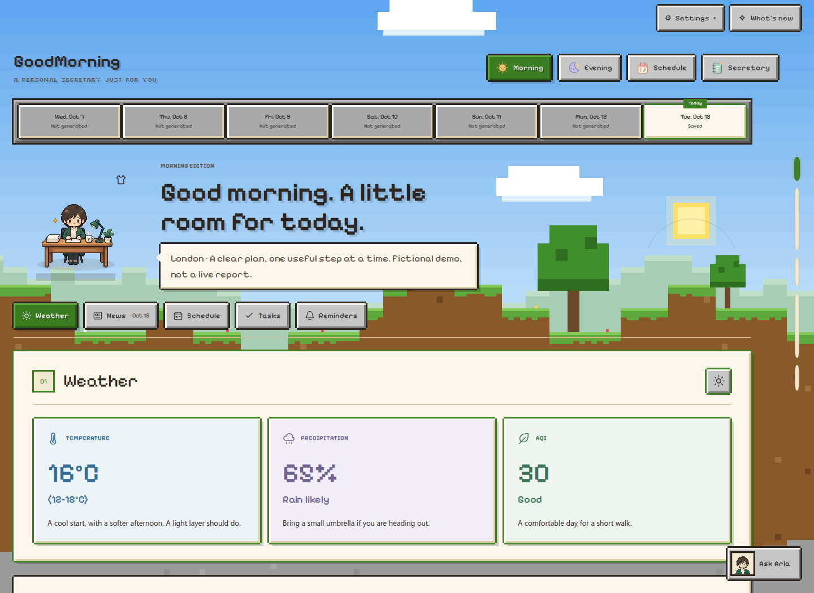
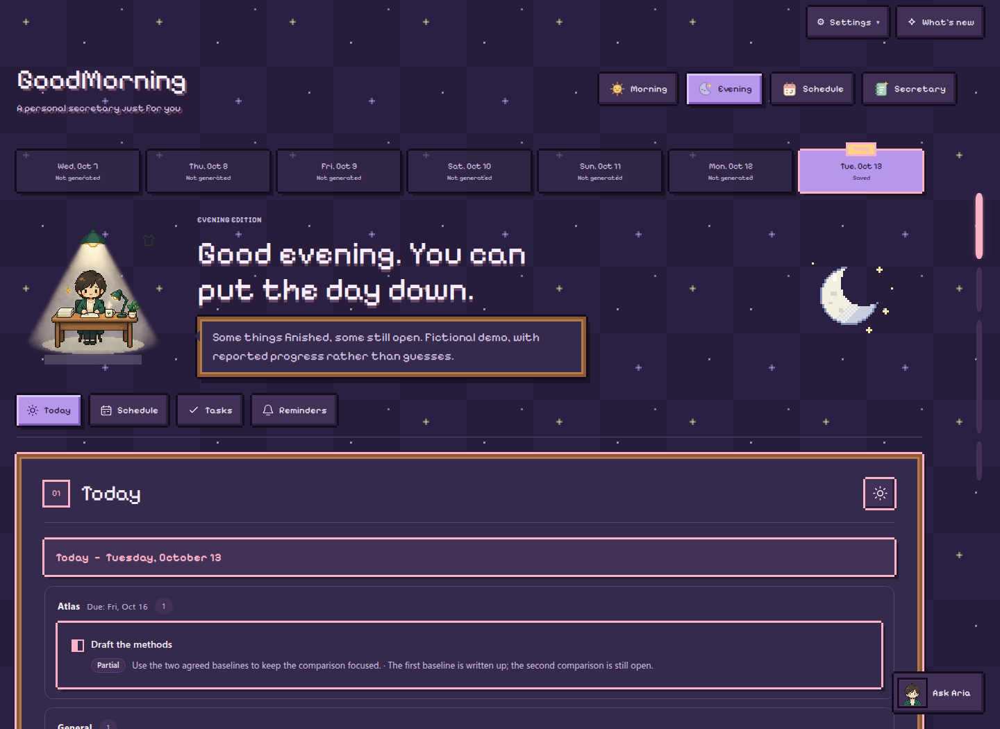

  

<h1 align="center">GoodMorning</h1>

  <strong>A calmer start. A clearer finish. A little space to think.</strong> 
  Your personal AI secretary for the plans, stories, and ideas that make up your day.

  <strong>English</strong> · <a href="README.zh-CN.md">简体中文</a>

  <a href="#a-day-with-goodmorning">Explore</a> ·
  <a href="#inside-the-briefings">Screenshots</a> ·
  <a href="#make-it-yours">Get started</a> ·
  <a href="docs/deployment.md">Documentation</a> ·
  <a href="https://github.com/S-Sebb/GoodMorning/issues">Feedback</a>

GoodMorning brings your weather, news, appointments, tasks, and ideas into one
quiet place. Start with a morning briefing, keep your saved plans close throughout
the week, and close the day with an honest review of what actually happened.

Between briefings, your secretary helps you think, remember a to-do, catch an
idea before it disappears, or run a small errand for you. Built around
**OpenCode and OpenChamber**, GoodMorning combines a personal AI workflow with a
browser interface you can host yourself. Four tabs—**Morning, Evening, Schedule,
and Secretary**—keep each part of the day within reach, and a floating **Ask**
button opens a quick chat without leaving the page.

## A day with GoodMorning

**Morning · Find your bearings.** Weather, News, Schedule, Tasks, then Reminders:
a familiar order for local conditions and air quality, source-linked stories from
the past 24 hours, today's appointments, saved actions, and decisions that need you.
Tasks are grouped by workday and project, with clear action titles and essential
work kept distinct from optional possibilities. Habits show up on the days they
are due, and errand results appear as their own cards. Sections appear as they are
prepared, so you can start reading before the whole briefing is ready.

**Evening · Put the day down.** Report completed work, partial progress, and
blockers, then look at tomorrow's appointments and agreed tasks, worded around
what to get ready tonight. Deadlines that have arrived get a gentle check, and
each project has an optional progress box. Unfinished work stays visible without
silently moving to a new date. Completion comes from you, not an AI guess.

**Schedule · See the shape of your week.** Switch between a Week view, with
appointments above dated to-dos, and a Day view with every event detail and
what's on now or next. Today is highlighted, with three weeks of navigation on
either side. Deadlines are marked on their due day, habit days are shown, and
recurring work, reported progress, and appointments with a time still to be
decided each have their place. Saved changes refresh without another AI call;
this is a view of your records, not a generated weekly plan. See the
[schedule guide](docs/weekly-schedule.md).

**Secretary · Keep a little space to think.** One conversation does it all:
save a to-do, jot down an idea, set up an errand, plan your week, or change a
preference. A **What can I ask?** guide and starter buttons show what your
secretary can do; starters only fill in the message box and never send. Each
reply says whether something was saved as a to-do or an idea, and when it's
unclear whether you want something saved or done, the secretary asks first.
File attachments, pasted images, Markdown replies, and saved conversation history
keep the details close; older To-do and Eureka chats stay in your history.

**Ask from anywhere.** Morning, Evening, and Schedule each have a floating quick
chat. Every reminder that needs a decision has a
**Review with your secretary** button that opens it with a starter line, and
nothing sends until you do.

<table>
  <tr>
    <td width="50%" valign="top"></td>
    <td width="50%" valign="top"></td>
  </tr>
  <tr>
    <td align="center"><em>A clear ending to the day.</em></td>
    <td align="center"><em>A place for plans and bright ideas.</em></td>
  </tr>
</table>

Current interface, fictional demo data. Weather, stories, plans, and conversations are examples, not personal records or live reports. No AI model or external integration was called to make these screenshots.

## Inside the briefings

From the forecast to the next useful action, everything has its own place.
These close-ups use the current layouts and fictional data; click a screenshot
to see it at full size. **Tasks** brings actions together by day and project;
**Reminders** keeps reviews, decisions and calendar changes separate.

<table>
  <tr>
    <td width="50%" valign="top"></td>
    <td width="50%" valign="top"></td>
  </tr>
  <tr>
    <td align="center"><strong>News with context.</strong> <em>Categories, summaries, limitations, and sources.</em></td>
    <td align="center"><strong>A schedule, not just a list.</strong> <em>Appointment times, preparation, and honest unknowns.</em></td>
  </tr>
  <tr>
    <td width="50%" valign="top"></td>
    <td width="50%" valign="top"></td>
  </tr>
  <tr>
    <td align="center"><strong>Space for priorities.</strong> <em>Workday and project groups, without repeated details.</em></td>
    <td align="center"><strong>A gentler tomorrow.</strong> <em>Look ahead without silently rescheduling unfinished work.</em></td>
  </tr>
</table>

**Know what changed.** Your synced calendar updates the schedule on its own;
Reminders says once what was added, moved or cancelled, and names any
appointment it now overlaps.

**A week within reach.** Appointments above, dated to-dos below, and reported
progress still visible. The weekly view reads saved plans without asking AI to
invent a schedule.

## A little atmosphere

Keep the same quiet workspace, with a different view outside. In
**Account → Appearance**, picture cards let you choose three things separately,
and each choice is saved to your account:

- **Style** shapes the components. **Soft** is rounded and calm; **Pixel** brings
  square frames, blocky buttons, and pixel headings, and each scheme adds its
  own touches, like Grass Block's stone buttons and hotbar week. Body text stays
  in an easy-to-read font.
- **Day color scheme:** Classic, Warm, Morning Sky, First Light, Grass Block, or Picnic.
- **Night color scheme:** Classic, Starry, City Lights, Midnight Violet, Grass Block, or Picnic.

Every style works with every scheme. Clouds and birds, a mountain valley, stepped
grass-block hills that turn to dirt and stone as you scroll, a gingham picnic
blanket, a twinkling night sky, or a harbor glowing with city lights bring a
little atmosphere without third-party image or font requests.

<table>
  <tr>
    <td width="50%" valign="top"></td>
    <td width="50%" valign="top"></td>
  </tr>
  <tr>
    <td align="center"><strong>Morning Sky · Soft.</strong> <em>A little cloud, a little breathing room.</em></td>
    <td align="center"><strong>Starry · Soft.</strong> <em>A quieter sky for the end of the day.</em></td>
  </tr>
  <tr>
    <td width="50%" valign="top"></td>
    <td width="50%" valign="top"></td>
  </tr>
  <tr>
    <td align="center"><strong>Grass Block · Pixel.</strong> <em>A blocky morning, still easy to read.</em></td>
    <td align="center"><strong>Picnic · Pixel.</strong> <em>A cozy blanket under the stars.</em></td>
  </tr>
  <tr>
    <td align="center" valign="top"></td>
    <td align="center" valign="top"></td>
  </tr>
  <tr>
    <td align="center"><em>Your morning, on a smaller screen.</em></td>
    <td align="center"><em>A conversation with room to reply.</em></td>
  </tr>
</table>

The <a href="tests/browser/readme_demo.py">demo capture helper</a> recreates these views from isolated fictional records using the real local viewer and a simulated conversation.

## Plans that stay honest

- **An appointment is not a task.** Reserved time belongs in Schedule; actions
  belong in Tasks; possibilities stay ideas until you choose to adopt them.
  A deadline does not silently reserve a workday, and an empty calendar does not
  mean you are free.
- **The right kind of item.** Besides to-dos and ideas, your secretary can save
  heads-ups that never ask to be ticked off, reference notes for moments it
  can't see (like when something runs out), and follow-ups such as "every day
  until I've bought it" that stop with one tick. You choose how many days ahead
  a deadline, birthday, or appointment is mentioned, separately for mornings
  and evenings.
- **Errands with a clear answer.** Ask your secretary to check something for you,
  like a price each morning. It tries the errand once while setting it up, then
  tells you only when the result is something you asked to hear. When a check
  fails, the morning briefing says what was tried and why.
- **Worded once, read the same every day.** When an item is saved, your secretary
  decides how it reads in the morning briefing, the evening briefing, and the
  Schedule tab. You can ask to change one place without changing the others.
- **Remember the rhythm, not a growing backlog.** Save agreed weekly, every-N-day,
  or specific-date task rules, with confirmed exceptions and supported conditions.
  Weekly classes without a confirmed time show on every date and become calendar
  events in one step once the time is known. Completion can be recorded on the
  day it actually happened without shifting the original recurring plan. These
  reminders appear in your briefings; they are not an unattended notification
  service.
- **A useful reminder has a reason.** Due reviews, calendar changes and
  unresolved decisions stay separate from ordinary work. Synced calendar changes
  apply on their own; Reminders says once what was added, moved, renamed or
  cancelled, and names any overlapping appointments.
- **A briefing presents your plans; it does not make them.** Mornings focus on
  today and evenings on tomorrow. Generating or regenerating a briefing does not
  create tasks, assign dates, or mark work done. Ambiguous scheduling is clarified
  before it is saved, and a bare weekday like "by Friday" means its next
  occurrence. Project writes require authorization.

The [item and timing guide](docs/item-taxonomy.md) explains these boundaries in detail.

## Thoughtful by design

- **Personal, not generic.** Choose your secretary's name, tone, and avatar, and
  tell it what to call you; briefing greetings use that name. The built-in
  secretaries have a daytime and a night scene, a head-and-shoulders portrait
  for chat, and come gently alive with a blink, swaying coffee steam, and a few
  pen strokes. Custom avatars take separate day, night, and profile pictures.
- **Two languages.** English and Simplified Chinese are available throughout the
  website, including a crisp pixel font for Chinese in Pixel style. Changing the
  interface language does not rewrite your saved records or earlier replies.
- **Comfortable on a phone, too.** Responsive layouts, a growing message box,
  floating buttons that slide away while you read, click-to-enlarge images,
  section tabs, reading progress, and reduced-motion support keep reading and
  conversation at the center.
- **Continuity without clutter.** Saved briefings, a seven-day archive selector,
  persistent tasks and ideas, and previous conversations keep useful context close.
  The seven-day selector is a browsing window, not a record-deletion policy.
- **Work stays visible.** The Little desk activity window follows running,
  queued, and waiting work across tabs, with a link back to the original page.
  Refreshing resumes the same briefing or conversation; a follow-up message can
  steer the secretary while it works. Pending questions and permissions remain
  available until you answer them.
- **Language-matched models.** English requests automatically use Muse Spark 1.3
  Contributor XHigh; Chinese requests use DeepSeek V4.1 Flash High (paid tier).
  No model selector is needed, and running requests keep their original model.
  **What's new** explains each update, and an open page never reloads itself over
  an unsent draft.
- **Your own space.** Personal records stay outside the public source. The hosted
  deployment supports authenticated HTTPS, encrypted storage, and separate agent
  accounts. Private messages are not saved in browser local storage.

## Make it yours

GoodMorning is currently **beta**. It runs on **Linux with Python 3.14+** and an
**OpenCode/OpenChamber agent**. Optional local or paired-remote project access needs **Node.js
22.18+**. It is not a standalone chatbot or an unattended daily service.

1. **Choose your home.** Follow the [manual deployment guide](docs/deployment.md)
   to install the `goodmorning` skill. The [browser guide](docs/browser-delivery.md)
   covers a local, loopback-only viewer; public HTTPS hosting needs the separate
   [security and account setup](docs/website-security.md). Opening this repository
   alone does not install the skill or provision a working account.
2. **Meet your secretary.** Open Initialize in the browser.
   [Guided initialization](docs/initialization.md) saves your
   confirmed preferences and permissions; optional integrations can remain pending.
   Ask Secretary later to review settings without resetting your records.
3. **Begin when you are ready.** Prepare a briefing from Morning or Evening,
   check Schedule, or start a conversation in Secretary, on the website or in the
   [Android app](docs/android-app.md). GoodMorning is used only through these
   pages; there are no terminal commands to run.

Weather and news need outbound HTTPS. Ordinary weather, modelled air quality,
and RSS/Hacker News collection do not require extra API keys. News covers **the
24 hours before your briefing is prepared**, with AI, world, and your chosen
countries' stories, and leaves out stories your previous morning briefing already
showed. Coverage and provider availability can be incomplete, and source links do
not imply independent fact-checking.

Self-hosting does not hide requests from the AI provider you choose, and storage
encryption does not hide live data from trusted server administrators. Read the
[security and privacy boundaries](docs/website-security.md) before hosting personal data.

For a closer look, explore [website conversations](docs/browser-chat.md),
[weekly schedules](docs/weekly-schedule.md), [authorized project access](docs/project-access.md),
and the [source layout](docs/project-structure.md). Deployment validation uses
isolated synthetic records, not your personal runtime.

Ideas, feedback, and focused improvements are welcome in
[GitHub Issues](https://github.com/S-Sebb/GoodMorning/issues).

## License

GoodMorning is licensed under the [MIT License](LICENSE).
Bundled [relay code](vendor/openchamber-relay/LICENSE) and fonts
([text fonts](assets/web/fonts/OFL.txt), [pixel fonts](assets/web/fonts/pixel-fonts-OFL.txt))
retain their respective license notices.
Theme imagery has its own [asset credits](docs/theme-asset-credits.md).

---

<em>Less noise. More space for your day.</em>

